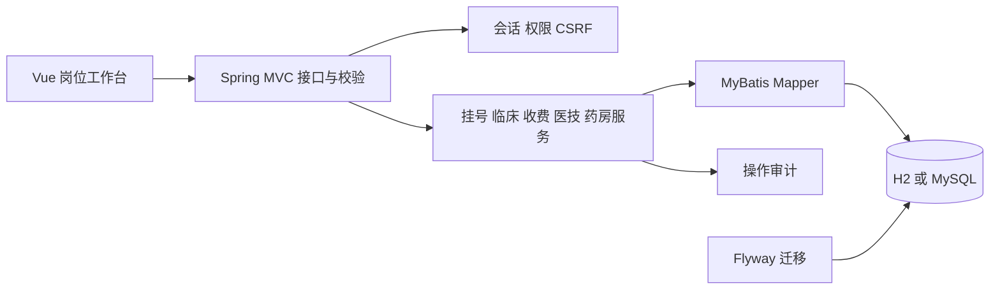

# 架构与数据设计

## 工程边界

采用前后端分离源码、单 JAR 发布的模块化应用。Vue/Element UI 负责表单与岗位工作台，Spring MVC 提供 REST 接口，业务服务统一处理权限、状态和事务，MyBatis 持久化。默认 H2 文件库便于本地运行，`mysql` profile 切换到 MySQL 8。

Java 源码分为 `web`、`service`、`mapper`、`config`、`common`。请求采用带约束的 Java record DTO，查询结果采用数据库列名映射，JSON 字段统一 snake_case。业务前置条件在 Service 中执行，前端按钮仅用于引导，不承担授权或金额计算责任。

## 数据关系

- `patient → encounter → medical_record / diagnosis / prescription / order_item`：患者可多次就诊；每次就诊一份病历和当前诊断。
- `schedule → encounter`：日期及时段独立容量，`booked<quota` 条件更新避免超挂。
- `order_item → invoice_line → invoice`：项目金额创建时快照，收费金额由后端读取项目累加。每个项目最多对应一条收费明细。
- `invoice_line → refund`：每条明细最多一笔全额退款。
- `order_item → execution_result`：每条医技项目最多一份执行结果，录入人必须与分配医生一致。
- `medicine → drug_movement`：每次入库、发药、退药都留数量变更和操作人；发退药记录可追溯至原处方项目。
- `app_user → audit_log`：保留登录、病历访问、修改、费用和库存等操作，日志不记录密码或病历正文。

所有金额用 BIGINT 存储人民币分，数量使用包装单位正整数，避免浮点金额误差。MySQL/H2 均有外键、唯一约束、金额约束及库存非负约束。

## 状态与事务

就诊：`REGISTERED → IN_PROGRESS → DIAGNOSED → COMPLETED`；仅 `REGISTERED → CANCELLED` 允许退号。

费用：`UNPAID → PAID → REFUNDED`；撤销未收费项保留 `UNPAID`，执行状态设为 `CANCELLED`，不会再出现在待收款选择中。

医技执行：`PENDING → REGISTERED → COMPLETED`；登记必须 `PAID`。药品执行：`PENDING → DISPENSED → RETURNED → CANCELLED`，最后一步发生于退费。

挂号收款、项目收费、退款、登记结果、药品出入库采用事务。收费锁定就诊和项目，执行/退款/发药锁定项目，防止并发改变消费状态。库存扣减使用 `stock>=quantity` 的条件更新。病历更新使用 version 乐观锁。

每次收费携带唯一 `request_key`，服务端保存请求内容指纹；重复相同请求返回原收费单，不同内容复用请求号被拒绝。并发相同项目只允许一个请求实际收费。挂号重复请求也不会重复生成费用；并发首次冲突可刷新重试。

## 安全和运行配置

服务端 HttpSession 管理登录，Cookie 设置 HttpOnly / SameSite Strict，生产 profile 强制 Secure。所有写接口验证会话 CSRF token，登录也需先获取会话。密码使用 BCrypt，失败登录有15分钟限流。停用账号后，既有会话的下一次请求即失效。

`prod` profile 禁止使用内置初始密码，`HIS_SEED=false` 时只创建管理员，由管理员配置科室、岗位、目录和排班。`mysql` 与 `prod` 可组合启用。生产需 HTTPS；单实例部署的 HttpSession 未做跨节点共享。

Flyway 从 `db/migration/V1__baseline.sql` 与 `V2__query_indexes.sql` 建立并管理结构。发布后不得修改已执行迁移；后续新增 `V3__...sql`。不要直接用原素材数据库脚本覆盖当前库。

## 后续上线条件

本版已经完成课程要求的门诊业务闭环。医院正式环境还需完成 MySQL 回归、容量与恢复演练、密码及权限政策确认、真实支付/医保/发票对账、药品质控规则、报告签名与更正流程。Vue 2 / Element UI 按原文档保留，长期维护需安排版本升级。
